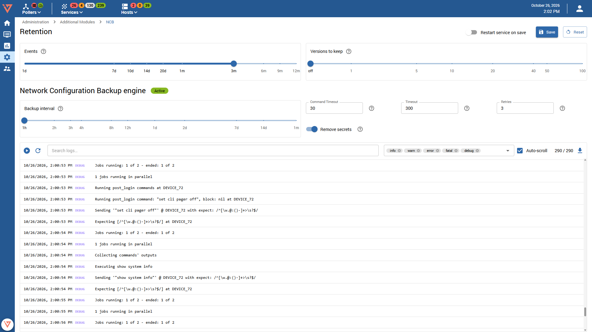

import Breadcrumb from "../../../src/components/Breadcrumb";

<Breadcrumb crumbs={["Administration", "Additional Modules", "NCB"]} />

On this page an administrator has the possibility to configure settings related to the backup service itself and retention settings for configuration backups, and view the backup service's logs. Do not forget to save the changes using the "Save" button. The option to restart the backup engine service exists by enabling the "Restart service" option. Note that you have to restart the service to apply changes made in the "Network configuration backup engine" section. Restarting the service entails a backup execution of all configured devices.

## Retention

There are 2 relevant settings in the retention section. The "Events" slider sets the retention time for the backup service events. This means that every event older than current date minus selected time will be erased and is therefore not available anymore in the events list. 
**The configurations themselves are not affected, as described next.**

The "Versions to keep" setting is not affected by time and defines how many configurations (sorted by newest first) should be kept available for viewing and diff in the "Configuration Versions" page. Adjust this setting if your network devices configuration gets updated often, e.g. by some kind of automated mechanism.

## Network Configuration Backup engine

These settings include:
* The interval of the backup job
* Command timeout: Maximum time to wait for a single operation during config fetching
* Timeout: Maximum total time allowed for the entire fetch job
* Retries: Number of attempts to retrieve the configuration before the job finishes with an error
* Remove secrets: To strip out secrets from configurations before storing them

## Oxidized Service Logs

This is a graphical representation of the logs generated by the oxidized (backup engine) service. They can be paused, refreshed and filtered using a basic content filter and severity filters. The raw logs can also be downloaded for local inspection or archival.
