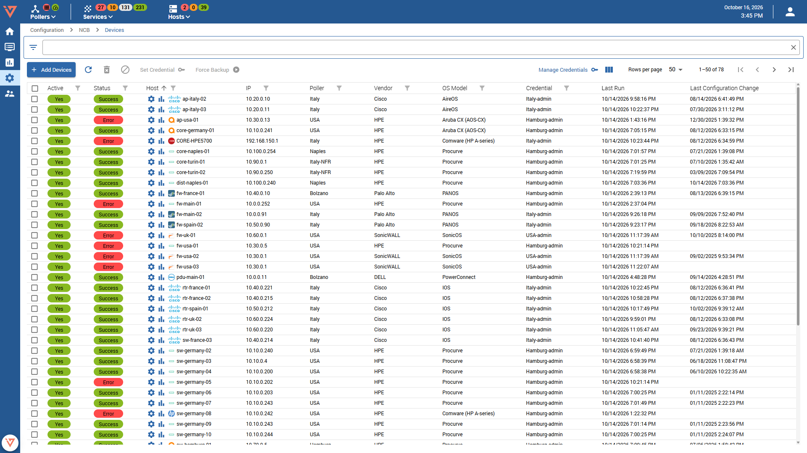
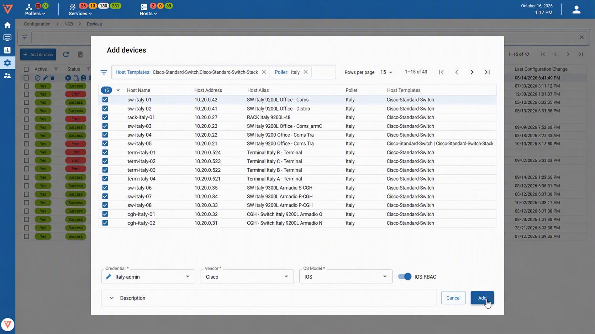

import Breadcrumb from "../../../src/components/Breadcrumb";

<Breadcrumb crumbs={["Configuration", "NCB", "Backups"]} />

Upon entering, you will be greeted with a list showing all configured backups for your hosts. The list can be filtered using the column filters. Filter options include:
* Hostname (regex match)
* Backup active status
* Last backup status
* IP (regex match)
* Poller
* Vendor
* OS Model
* Credential

Furthermore, the list can be sorted. Upon hover, each individual row has some actions that can be performed. Actions include:
* Edit (clicking the row itself performs this action as well)
* Enable/Disable
* Delete
* Force Backup
* [Show device configuration](./ncb-view-configuration) 
* [Compare configuration versions](./ncb-view-configuration)
* [Events](./ncb-view-configuration)

## Mass Device onboarding

* Click "Add Devices"
* A modal opens showing a list of hosts that are not configured for backup yet. Make use of the filter possibilities to find the correct hosts.

* Select the hosts one by one or select all on the current page. 
* By clicking the small arrow on the right of the "select all" checkbox you can "Select all across pages". This selects all devices that meet the filter specification, across all list pages.
* Specify the Credential, Vendor and OS Model and click Save to enable backing up the selected devices.

## Configuring a device backup after creation

* Click the row or the edit button of the device that needs its configuration adjusted. A sidepanel will open.
* In the sidepanel you have the possibility to change the credential, Vendor, OS Model, enable or disable the backup and set notes. Change accordingly and save, or save and backup to force schedule a backup immediately.
* Keep in mind that batch actions and row actions are disabled for the device open in the sidepanel.

## Batch actions

- On top of the list you can find the available batch actions:
  - Enable/Disable: Enables or disables the backup configuration for selected hosts. If at least one selected backup is disabled, enabled will be the available batch option.
  - Delete: Deletes the backup configuration for selected backup configurations.
  - Force backup: Schedules a backup immediately
  - Set Credential: Set a credential for all selected backup configurations

## Manage credentials

Clicking the "Manage Credentials" button opens the credential manager from the backup configurations list.
This allows adding, editing and removing SSH credentials available for later use in configurations.

Note that if a credential is used in a backup configuration, it cannot be deleted. Please change the backup configurations credential beforehand.
