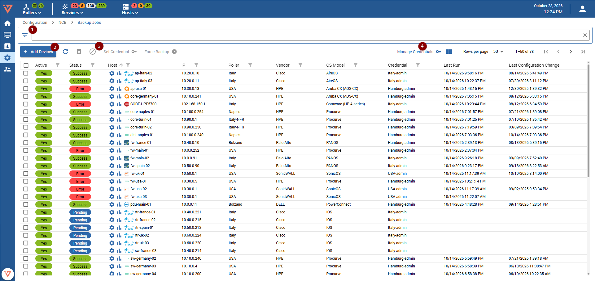
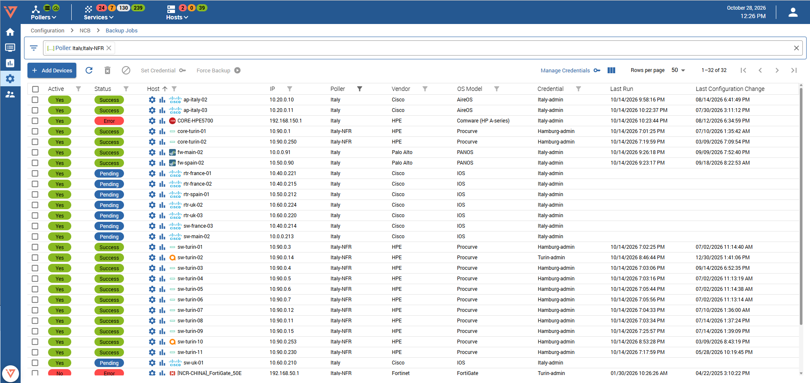
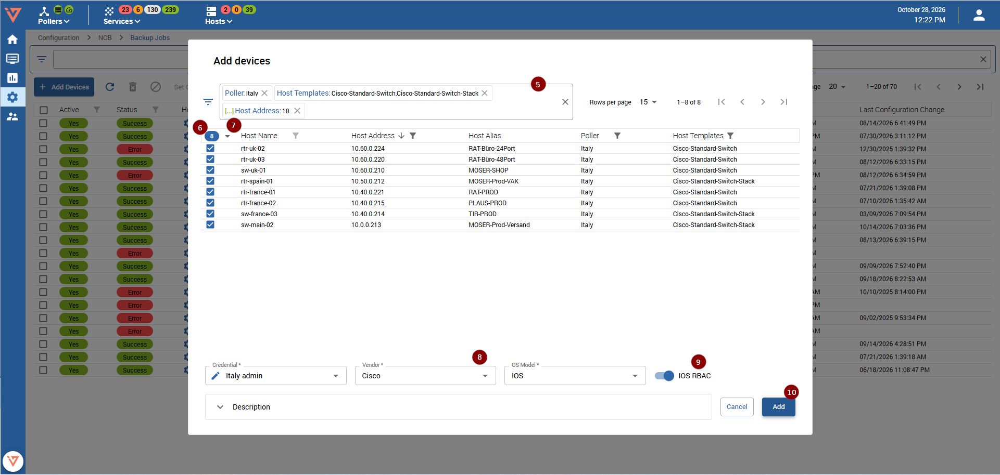
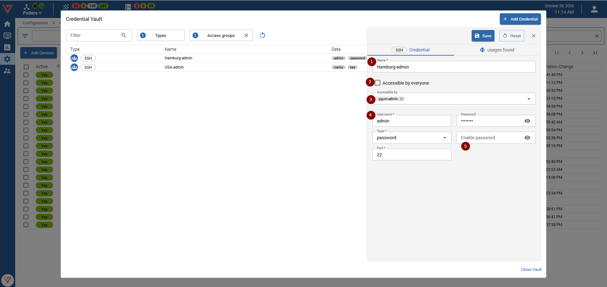
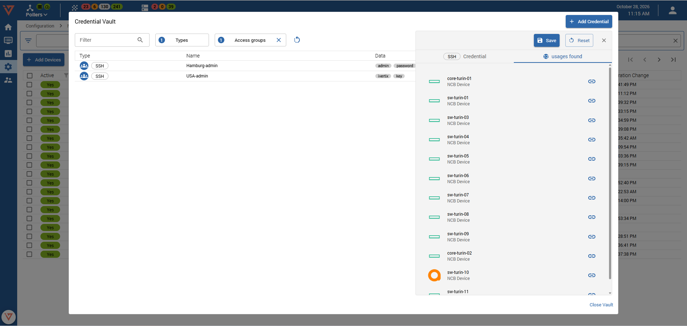

import Breadcrumb from "../../../src/components/Breadcrumb";
import ImageCounter from "../../../src/components/ImageCounter";

<Breadcrumb crumbs={["Configuration", "NCB", "Backup Jobs"]} />

Upon entering, you will be greeted with a list showing all configured backups for your hosts. The list can be filtered <ImageCounter num={1} /> using the column filters. Filter options include:
* Hostname (regex match)
* Backup active status
* Last backup status
* IP (regex match)
* Poller
* Vendor
* OS Model
* Credential

Furthermore, the list can be sorted. Upon hover, each individual row has some actions that can be performed. Actions include:
* Edit (clicking the row itself performs this action as well)
* Enable/Disable
* Delete
* Force Backup
* [Show device configuration](./ncb-view-configuration) 
* [Compare configuration versions](./ncb-view-configuration)
* [Events](./ncb-view-configuration)

## Mass Device onboarding

* Click "Add Devices" <ImageCounter num={2} /> 

* A modal opens showing a list of hosts that are not configured for backup yet. Make use of the filter <ImageCounter num={5} /> possibilities to find the correct hosts.
* Select the hosts one by one or select all <ImageCounter num={6} /> on the current page. 
* By clicking the small arrow <ImageCounter num={7} /> on the right of the "select all" checkbox you can "Select all across pages". This selects all devices that meet the filter specification, across all list pages.
* Specify the Credential, Vendor and OS Model <ImageCounter num={8} />.
* If you are configuring a Cisco IOS device the option to use IOS RBAC <ImageCounter num={9} /> will be available.
* Click "Add" <ImageCounter num={10} /> to add backup jobs for selected devices.

<h5 id="credential-vault">Credential Vault</h5>

When opening the *Credential Vault* you can see a list of all existing credentials of type SSH.

To create a new credential, click the `Add Credential` button on the top right of the dialog. On the right side of the dialog,
a form will open where you can enter the required information for your new credential: 

* <ImageCounter num={1} /> **Name**: Choose a descriptive name for the new credential
* <ImageCounter num={2} /> **Accessible by everyone**: This checkbox is only available while being logged in as an administrator. If you check this checkbox, 
  any previously selected access groups are omitted and the new credential will be accessible by everyone, regardless of access groups. Be careful with this setting.
* <ImageCounter num={3} /> **Accessible by**: Choose access groups, which will have access to the new credential.
  As an administrator, you can omit this field to grant access only to administrators
* <ImageCounter num={4} /> Set username, password and SSH port accordingly
* <ImageCounter num={5} /> Set the password for the enable command. Some devices require this command to allow reading configuration.

This view shows all backup jobs which use the current credential. As long as the credential has usages it cannot be deleted. Make sure to change the credential of the backup jobs in this list before attempting deletion.

## Configuring a device backup after creation

* Click the row or the edit button of the device that needs its configuration adjusted. A sidepanel will open.
* In the sidepanel you have the possibility to change the credential, Vendor, OS Model, enable or disable the backup and set notes. Change accordingly and save, or save and backup to force schedule a backup immediately.
* Keep in mind that batch actions and row actions are disabled for the device open in the sidepanel.

## Batch actions <ImageCounter num={3} /> 

- On top of the list you can find the available batch actions:
  - Enable/Disable: Enables or disables the backup configuration for selected hosts. If at least one selected backup is disabled, enabled will be the available batch option.
  - Delete: Deletes the backup configuration for selected backup configurations.
  - Force backup: Schedules a backup immediately
  - Set Credential: Set a credential for all selected backup configurations

## Manage credentials <ImageCounter num={4} /> 

Clicking the "Manage Credentials" button opens the credential manager from the backup configurations list.
This allows adding, editing and removing SSH credentials available for later use in configurations.

Note that if a credential is used in a backup configuration, it cannot be deleted. Please change the backup configurations credential beforehand.
