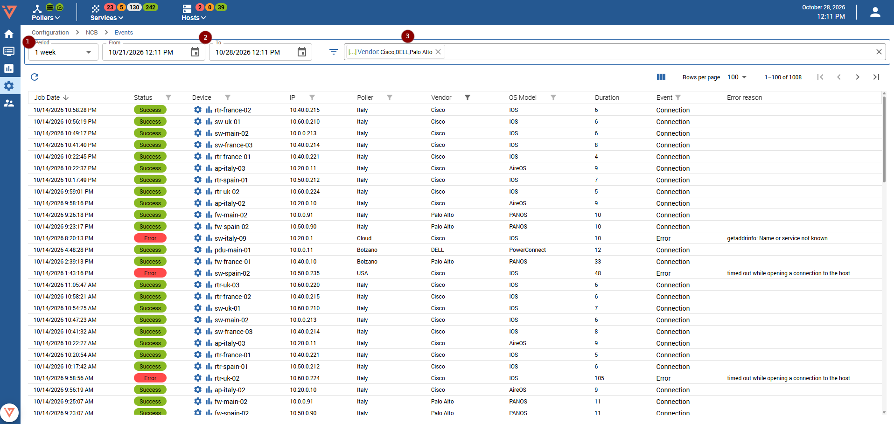

import Breadcrumb from "../../../src/components/Breadcrumb";
import ImageCounter from "../../../src/components/ImageCounter";

<Breadcrumb crumbs={["Configuration", "NCB", "Event Logs"]} />

This page shows a list of events generated by the backup service. The period <ImageCounter num={1} /> can be set using the preexisting settings or customised to your need using the calendar <ImageCounter num={2} /> values. 

This list can additionally be filtered <ImageCounter num={3} /> by:
* Status
* Hostname (regex match)
* IP (regex match)
* Poller
* Vendor
* OS Model
* Event

### Success

A success event can be one of two different things. If there were no network configuration changes for the specified host there will only be a single success entry, with event "Connection". However, if a difference since the last backup attempt was detected, a second event "Configuration Backup" will be created. From there you have the possibility the jump to the configuration backup in the [Configuration Viewer](./ncb-view-configuration).

### Error

An error occurred while backing up the device. Errors can happen for many different reasons, but mostly due to misconfiguration. Looking at the error description gives a hint on why the error occurred. If you notice an error related to the backup service itself and not a misconfiguration or inability to connect to a host, please check the logs in the [Administration](./ncb-administration) page. If you are a normal user do not hesitate to contact your local administrator.