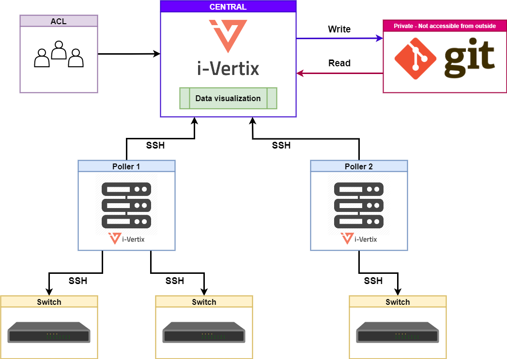

* Automatic backup of network device configurations
* Mass device onboarding
* Multi vendor support
* Configurations saved in a GIT repository
* Versions comparison
* Backup content search (contains, not contains or matches regex)
* Integrated in i-Vertix IT Monitoring
* Utilises i-Vertix Vault credentials
* MSP ready

## Technical diagram and data flow

**Central**: data visualisation via HTTPS, backup storage on GIT repository, monitored device configurations. Users can access data according to the type of permissions assigned to them via ACLs.

**Git**: the repository is private and not accessible from outside, data is read and updated from Central.

**Poller**: [SSH](https://en.wikipedia.org/wiki/Secure_Shell) is used to communicate with Central to send configuration backups.

**Network device** (switch, firewall, router): Pollers connect via [SSH](https://en.wikipedia.org/wiki/Secure_Shell) and depending on the set Vendor + OS Model combination the required commands are executed on the network device to extract the network configuration and forward it to Central for backup.
