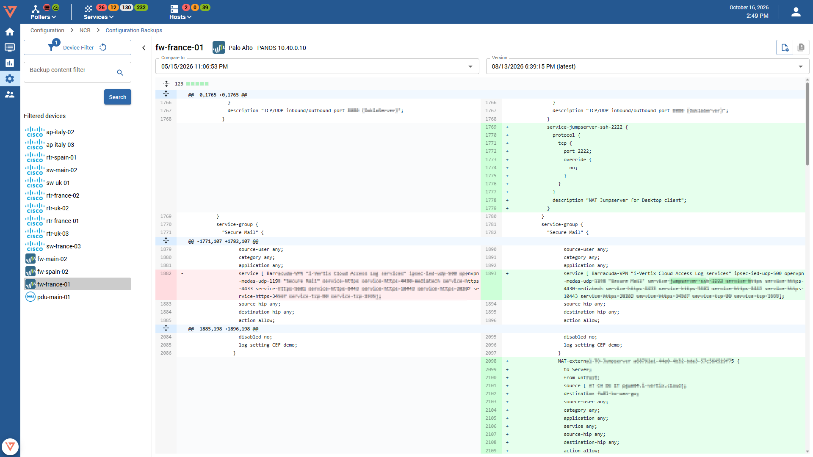

import Breadcrumb from "../../../src/components/Breadcrumb";

<Breadcrumb crumbs={["Configuration", "NCB", "Configuration Versions"]} />

This page is divided into 2 parts. 

## Left hand side: Devicelist
On the left hand side you can see a **collapsible** list of devices that have at least one configuration backup up. If you cannot find your host in this list, make sure its backup configuration has the correct credential, vendor and OS model set, and is active. An inactive host is never backed up, even if the backup of said host is enabled.

The list can be filtered by different parameters. Clicking the "Device filter" button reveals the available filter options in a popover. Click the reset icon on top of the "Device filter" button or inside the popover to reload the list without those filters.

Located below the "Device filter" button is the backup content filter. Use this filter to find/exclude/match content in the latest version of all backed up configurations to find/exclude/match the entered content. Click the iconbutton beside the textarea to change the search behaviour to "Contains", "Not containes" or "Matches".

## Right hand side: Configuration viewer mode

On the right hand side you can see the backed up configuration of the selected device. Normally the latest version will be shown upon device selection. However, if you clicked on "Show configuration" in the [Events](./ncb-events) list to reach this page, the selected version will be shown instead.
Additionally, lines matching the content of "Backup content filter" will be highlighted, if "Contains" or "Matches" is selected.

If there are at least 2 versions available the "Show diff" view can be selected using the Diff Button in the top right corner.

## Right hand side: Diff viewer mode

The diff view shows the diff between the two selected configuration versions, where the newer version is on the right. Aside from the relevant changes, the remaining configuration can also be viewed in this mode by clicking the expand buttons above and below the leftmost line numbers.
