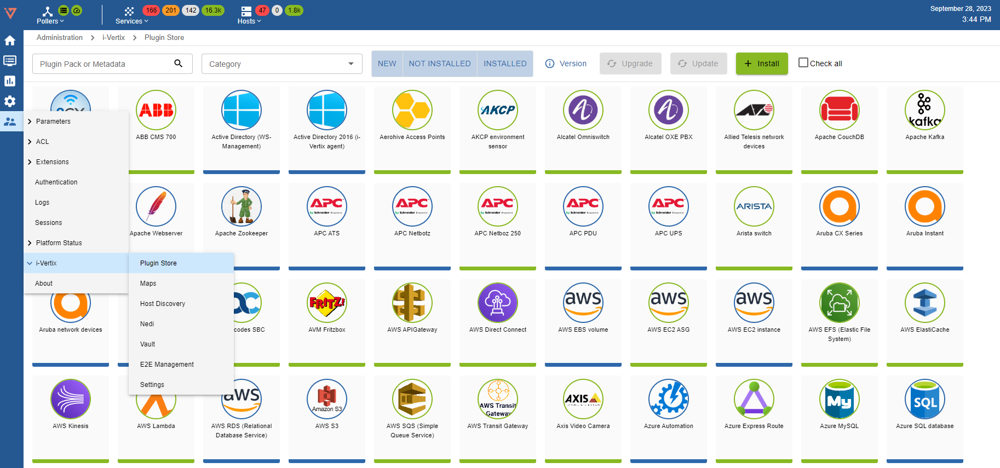
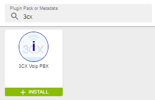

import Breadcrumb from "@site/src/components/Breadcrumb";

The plugin packs documented here are installed and kept up to date through the *Plugin Store* of i-Vertix IT Monitoring.
This page gives a short overview; the full procedure is described in
[Plugin Store and Plugin Packs](/monitoring/monitoring-resources/plugin-packs).

:::tip

The *Plugin Store* credentials must be configured before you can access the store, see the
[Plugin Store Configuration Guide](/monitoring/quick-start-guide/plugin-store-configuration).
If you have not received your personal credentials yet, contact the [i-Vertix support](mailto:support@i-vertix.com).

:::

## Installing a plugin pack

1. Open the *Plugin Store* at <Breadcrumb crumbs={["Administration", "Stores", "Plugin Store"]} />.
2. Search the plugin pack by name or metadata (e.g. `API`, `SNMP`, `SSH`) in the **Plugin Pack or Metadata** field,
   or filter by **Category** and installation status.
3. Hover over the plugin pack and click on **+ Install**. Several plugin packs can be selected and installed at once
   with **Install** in the top bar.

Once installed, the plugin pack has a green outline and a green check mark.
Some plugin packs need additional steps (e.g. API credentials, SNMP access, an agent on the monitored host):
check the *Prerequisites* section of the plugin pack page in this documentation.

## Updating and upgrading the Plugin Store

To install a new *Plugin Store* version (see the [Release Notes](./release-notes.md)), follow
[Updating/Upgrading the Plugin Store](/monitoring/monitoring-resources/plugin-packs#updatingupgrading-the-plugin-store)
in the IT Monitoring documentation.
