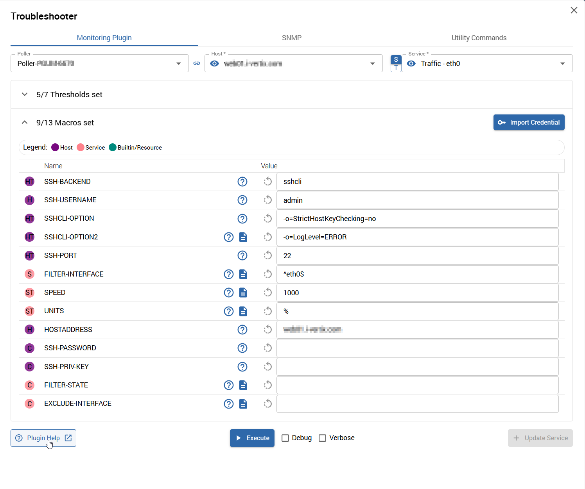

The plugin pack pages of this documentation describe the **latest published** *Plugin Store* version, shown at the
top right of every page. To bring your installation to this version, see
[Updating and upgrading the Plugin Store](./plugin-store.mdx#updating-and-upgrading-the-plugin-store).

To see all options of the plugins **installed on your system**, use the *Monitoring Troubleshooter*
(**Monitoring Plugin** tab), as described in
[Troubleshooting Monitoring Plugins](/monitoring/monitoring-resources/troubleshooting#troubleshooting-monitoring-plugins):

- the **?** icon next to a macro shows the help of the plugin option the macro is passed to
- **Plugin Help** opens the complete help of the monitoring plugin in a new browser tab

